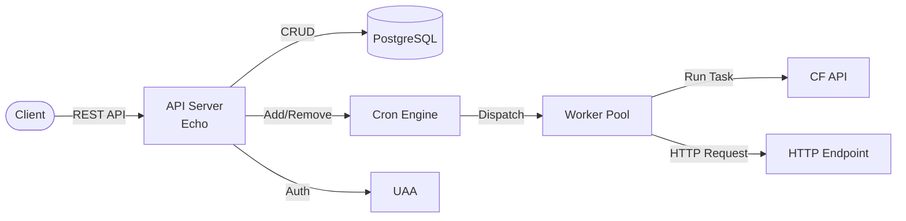

# OCF Scheduler

A standalone Go service that provides cron-style scheduling for Cloud Foundry applications.
It enables users to schedule CF tasks (jobs) and HTTP calls using cron expressions with timezone support.

## Features

- Schedule Cloud Foundry tasks (jobs) to run on cron expressions

- Schedule HTTP calls to run on cron expressions

- Timezone-aware scheduling with RFC 9636 timezone support

- Execution history tracking for both jobs and calls

- Configurable worker pool for concurrent execution

- Automatic cleanup of old execution records

- UAA-based authentication and authorization

- An optional Open Service Broker API, so a space turns the scheduler on with `cf create-service` and an app joins it with `cf bind-service`

## Architecture



On startup, the scheduler loads all enabled schedules from PostgreSQL and registers them with the cron engine.
When a schedule fires, the cron engine dispatches the work to the worker pool,
which either creates a CF task via the CF API or makes an HTTP call to the configured endpoint.

## Project Structure

| Directory | Description |
|---|---|
| `cmd/scheduler/` | Main scheduler service entry point and version metadata |
| `broker/` | Open Service Broker API, its catalog, and its configuration |
| `cmd/tzlist/` | Timezone list generation utility |
| `cmd/cli/` | CLI testing tool for interacting with the scheduler for local development |
| `cmd/jeuaa/` | Mock UAA server for local development |
| `cmd/jecfapi/` | Mock CF API server for local development |
| `core/` | Domain models (`Job`, `Call`, `Schedule`, `Execution`) and service interfaces |
| `http/` | Echo HTTP server, route handlers, and response presenters |
| `postgres/` | PostgreSQL implementations of service interfaces and database migrations |
| `cron/` | Cron scheduling engine with timezone support |
| `cf/` | Cloud Foundry integration (UAA auth, CF API info, task execution) |
| `combined/` | Combined run service that routes to job or call runners |
| `logger/` | Logrus-based logging service with custom formatter |
| `workflows/` | Business logic workflows |
| `mock/` | Mock implementations for testing |
| `features/` | Integration/feature tests |
| `scripts/` | Utility scripts (`blanket` test runner, `shait` digest generator) |
| `ci/` | Concourse CI pipeline configuration, tasks, and scripts |

## Getting Started

### Prerequisites

- Go 1.25+ (see `go.mod`)

- PostgreSQL

- Cloud Foundry deployment with UAA

- Docker and Docker Compose (optional, for local development)

### Docker Development Environment

A `docker-compose.yml` is provided for local development and testing without a real
Cloud Foundry deployment. It spins up mock UAA and CF API services alongside PostgreSQL:

```sh
docker compose up dev          # Run the scheduler with mock services
docker compose up test         # Run the test suite
```

| Service | Description | Port |
|---|---|---|
| `dev` | Scheduler service (built from `Dockerfile.dev`) | 8000 |
| `test` | Test runner (built from `Dockerfile.test`) | — |
| `postgres-dev` | PostgreSQL for development | — |
| `postgres-test` | PostgreSQL for tests | — |
| `uaa` | Mock UAA server (built from `Dockerfile.uaa`) | 8001 |
| `cf-api` | Mock CF API server (built from `Dockerfile.cfapi`) | 8002 |

The `dev` service pre-configures all required environment variables (`DATABASE_URL`,
`UAA_ENDPOINT`, `CF_ENDPOINT`, `CLIENT_ID`, `CLIENT_SECRET`) so you can start the
scheduler immediately.

### Configuration

| Variable | Required | Default | Description |
|---|---|---|---|
| `DATABASE_URL` | Yes | | PostgreSQL connection string |
| `CF_ENDPOINT` | Yes | | Cloud Foundry API URL |
| `UAA_ENDPOINT` | Yes | | UAA server URL |
| `CLIENT_ID` | Yes | | UAA client ID |
| `CLIENT_SECRET` | Yes | | UAA client secret |
| `SCHEDULER_PORT` | No | `8000` | HTTP listen port |
| `SCHEDULER_WORKERS` | No | `20` | Worker pool size (minimum 10); values below 10 or non-numeric values log a warning and fall back to 20 |
| `LOG_LEVEL` | No | `info` | Log level (see below) |
| `SCHEDULER_BROKER_ENABLED` | No | `false` | Serves the service broker under `/v2` when it is `true` |
| `SCHEDULER_BROKER_USERNAME` | When the broker is on | | The basic auth username that Cloud Controller sends to the broker |
| `SCHEDULER_BROKER_PASSWORD` | When the broker is on | | The basic auth password that Cloud Controller sends to the broker, at least 16 characters long |
| `SCHEDULER_BROKER_API_URL` | When the broker is on | | The scheduler URL that binding credentials hand to apps, such as `https://scheduler.system.example.com` |
| `SCHEDULER_BROKER_REQUIRE_BINDING` | No | `false` | Refuses to create or run jobs, calls, and schedules for an app that isn't bound, when it is `true` |

The scheduler refuses to start when the broker settings don't fit together. That happens when `SCHEDULER_BROKER_ENABLED` is `true` and the username, password, or API URL is missing, when the password is shorter than 16 characters, when the username starts or ends with whitespace, when the API URL isn't an absolute `http` or `https` URL, when a boolean setting holds anything other than a boolean, and when `SCHEDULER_BROKER_REQUIRE_BINDING` is `true` while the broker is off. The startup log names the broker user, the API URL, and the `require_binding` setting, and it never prints the password.

#### Log Levels

The `LOG_LEVEL` environment variable accepts a single keyword and is parsed by
[`logrus.ParseLevel()`](https://pkg.go.dev/github.com/sirupsen/logrus#ParseLevel),
which is **case-insensitive**. The accepted values, ordered from most to least verbose:

| Value | Description |
|---|---|
| `trace` | Very fine-grained diagnostic output |
| `debug` | Debugging information |
| `info` | General operational messages (default) |
| `warn` | Potential issues that deserve attention |
| `warning` | Alias for `warn` — both are accepted |
| `error` | Errors that need investigation |
| `fatal` | Critical errors — the process will exit after logging |
| `panic` | Critical errors — the process will panic after logging |

Setting a log level enables messages at that level **and all higher-severity levels above it**.
Messages below the configured level are suppressed. For example, setting `LOG_LEVEL=warn`
will output `warn`, `error`, `fatal`, and `panic` messages, but suppress `info`, `debug`,
and `trace`.

If `LOG_LEVEL` is not set or is empty, the default is `info`.
If an invalid value is provided, a warning is logged and the level falls back to `info`.

### Building

```sh
make build        # Build for current platform
make release      # Build for all target platforms
make test         # Run tests
make clean        # Remove built executables
```

## Makefile Reference

### Targets

| Target | Description |
|---|---|
| `all` | Clean and build (default target) |
| `build` | Build for current platform; automatically adds a `dev` prerelease tag |
| `cli` | Build the CLI tool (`sch` binary) |
| `release` | Cross-compile for all target platforms and create tar.gz packages |
| `test` | Run the test suite via `scripts/blanket` |
| `clean` | Remove built executables (`./tzlist`, `./scheduler`) |
| `distclean` | Remove all release directories and packages (includes `clean`) |
| `distbuild` | Create release directory structure for all targets |
| `debug_version` | Display all computed version variables (useful for troubleshooting) |

### Public Variables

These can be overridden on the command line (e.g., `make build VERSION=1.2.3`):

| Variable | Default | Description |
|---|---|---|
| `VERSION` | *(auto from git tag + patch bump)* | Full version string (e.g., `1.2.3`, `1.2.3-alpha`) |
| `APP_NAME` | `scheduler` | Binary output name |
| `CMD_PATH` | `cmd` | Command source directory |
| `RELEASE_ROOT` | `releases` | Release output directory |
| `TARGETS` | `linux/amd64 linux/arm64 darwin/amd64 darwin/arm64` | Cross-compile target platforms |
| `MODULE` | `github.com/cloudfoundry-community/ocf-scheduler` | Go module path |
| `CGO_ENABLED` | `0` | Set to `1` to enable CGO (default produces static binaries) |
| `SEMVER_MAJOR` | *(auto)* | Major version override |
| `SEMVER_MINOR` | *(auto)* | Minor version override |
| `SEMVER_PATCH` | *(auto)* | Patch version override |
| `SEMVER_PRERELEASE` | *(auto)* | Prerelease label override |
| `SEMVER_BUILDMETA` | *(auto)* | Build metadata override |

### Private Variables

These are computed internally and not intended for direct override:

| Variable | Description |
|---|---|
| `PROJECT` | Hardcoded project name (`ocf-scheduler`) |
| `GOOS` / `GOARCH` | Detected from `go env` for the current platform |
| `GOMODULECMD` | Go package path for ldflags injection (`main`) |
| `TESTFILES` | List of Go packages (excluding vendor) |
| `CLEAN_VERSION` | `VERSION` with `v` prefix stripped |
| `HAS_BUILDMETA` / `VERSION_BUILDMETA` | Buildmeta detection and extraction from `VERSION` |
| `HAS_PRERELEASE` / `VERSION_PRERELEASE` | Prerelease detection and extraction from `VERSION` |
| `VERSION_ONLY` | Semantic version without prerelease or buildmeta |
| `VERSION_SPLIT` | Version parts as a Make word list (major minor patch) |
| `BUILD_DATE` | ISO 8601 timestamp of the build |
| `BUILD_VCS_URL` | Git remote origin URL |
| `BUILD_VCS_ID` | Short git commit hash |
| `BUILD_VCS_ID_DATE` | ISO date of the git commit |
| `GO_LDFLAGS` | Linker flags that inject version metadata into the binary |
| `SEMVER_VERSION` | Fully assembled semantic version string |

### Macros and Functions

| Name | Type | Description |
|---|---|---|
| `is_not_number` | Function | Strips digits from a string; used to validate that version components are numeric |
| `distbuild` | Macro | Creates a release directory for a given OS/ARCH combination under `RELEASE_ROOT` |
| `build-target` | Macro | Cross-compiles binaries for a specific OS/ARCH and generates SHA1/SHA256 digests via `scripts/shait` |
| `package-target` | Macro | Creates a tar.gz package for a specific OS/ARCH release directory |

### Version Auto-Detection

When `VERSION` is not specified, the Makefile:

1. Reads the latest git tag (e.g., `v1.2.3`)
2. Strips the `v` prefix
3. Validates the tag has exactly 3 numeric parts (major.minor.patch)
4. Auto-increments the patch number by 1

For example, if the latest tag is `v1.2.3`, the computed version becomes `1.2.4`.
The `build` target additionally appends `-dev` as the prerelease label (e.g., `1.2.4-dev`).

## Development Workflow

### Local Build

```sh
make build
```

Compiles `scheduler` and `tzlist` binaries for your current platform. The version is
automatically tagged with a `-dev` prerelease label (e.g., `1.2.4-dev`).

To build with a specific version:

```sh
make build VERSION=1.2.3
make build VERSION=1.2.3-beta
```

### Running Tests

```sh
make test
```

Runs the test suite via `scripts/blanket`, which supports scoped test execution:

```sh
./scripts/blanket func          # All tests, display per-function coverage
./scripts/blanket html          # All tests, open coverage report in browser
./scripts/blanket func unit     # Unit tests only
./scripts/blanket func integration  # Integration tests only
```

### Debugging Version Computation

```sh
make debug_version
```

Prints all computed version variables (`VERSION`, `CLEAN_VERSION`, `VERSION_SPLIT`,
`SEMVER_*`, etc.) — useful when troubleshooting version-related build issues.

### Cross-Compiling Locally

```sh
make release
```

Builds for all target platforms (`linux/amd64`, `linux/arm64`, `darwin/amd64`,
`darwin/arm64`), generates SHA1/SHA256 digests, and creates tar.gz packages under
the `releases/` directory.

To build a specific version as a release:

```sh
make release VERSION=1.2.3
```

### Cleaning Up

```sh
make clean       # Remove built executables (./tzlist, ./scheduler)
make distclean   # Remove all release artifacts and executables
```

## Service Broker

The scheduler can serve the [Open Service Broker API](https://github.com/openservicebrokerapi/servicebroker) on its own port, under `/v2`, so that Cloud Foundry users manage it with the usual `cf` commands. The broker is off unless `SCHEDULER_BROKER_ENABLED` is `true`, and the settings it needs are in [Configuration](#configuration).

### Registering the broker

An operator registers the broker with Cloud Foundry and then makes its plan visible.

```sh
cf create-service-broker scheduler <SCHEDULER_BROKER_USERNAME> <SCHEDULER_BROKER_PASSWORD> https://scheduler.system.example.com
cf enable-service-access scheduler
```

The catalog offers one service, `scheduler`, with one free plan, `standard`. Their IDs are fixed, so a broker registered once keeps working across upgrades.

### How the broker behaves

Every request must carry `X-Broker-API-Version` 2.13 or later. A request without it, or with an older version, gets `412 Precondition Failed` before its credentials are checked. A request with the wrong credentials gets `401 Unauthorized`. The broker credentials open only `/v2`, and the scheduler API still wants a UAA token.

- Creating a service instance turns the scheduler on for the instance's space. A space holds only one instance, so a second `cf create-service` in the same space gets `409 Conflict`. When Cloud Controller no longer knows the space's existing instance, which happens after `cf purge-service-instance`, the broker replaces it as if it had been deleted.

- Binding an app lets that app be scheduled. The binding credentials hold `api_url`, `instance_id`, and `app_guid`, and they never hold a secret, because each caller still authenticates with their own UAA token. The app must live in the instance's space. A service key binds no app and carries only `api_url` and `instance_id`.

- Unbinding an app's last binding pauses the app's schedules. The broker disables each enabled schedule on the app's jobs and calls, marks it as paused by the unbind, and takes it out of cron. Jobs, calls, schedules, and execution history all stay.

- Binding the app again resumes only the schedules that the unbind paused. A schedule that its owner disabled stays disabled.

- Deleting the instance removes its bindings first, which pauses each app that loses its last binding, and then removes the instance. The space's jobs, calls, schedules, and execution history all stay, even when the space itself is deleted. An admin can find and remove them later, as [Cleaning up orphaned jobs and calls](#cleaning-up-orphaned-jobs-and-calls) describes.

Every operation finishes before the broker answers, so the broker never answers `202 Accepted` and has no operation to poll. Changing the plan isn't supported.

### Rolling back

Version 2.2.0 adds three database migrations, 1791828900, 1791828901, and 1791828902, which create the `service_instances` and `service_bindings` tables and add the `schedules.paused_by` column. Releases before 2.2.0 refuse to start against a database that holds a migration they don't know, so rolling back from 2.2.0 to a 2.1.x release needs those three migrations reverted first. The scheduler has no command that runs their down steps, so we run them by hand.

First, stop every scheduler instance. Then connect to the scheduler's database with `psql` and run the following, which drops the two tables and the column and deletes the three rows that sql-migrate keeps in `gorp_migrations`:

```sql
BEGIN;
-- Optional: let the schedules that an unbind paused run again on 2.1.x.
UPDATE schedules SET enabled = true WHERE paused_by = 'unbind';
ALTER TABLE schedules DROP COLUMN IF EXISTS paused_by;
DROP TABLE IF EXISTS service_bindings;
DROP TABLE IF EXISTS service_instances;
DELETE FROM gorp_migrations WHERE id IN ('1791828900', '1791828901', '1791828902');
COMMIT;
```

Deleting the rows alone would let 2.1.x start, but a later upgrade to 2.2.0 would then fail to create tables that already exist, so the procedure drops them too. It removes every service instance and binding, and Cloud Controller still lists the instances until they're purged with `cf purge-service-instance`. Without the optional `UPDATE`, the schedules that an unbind paused stay disabled after the rollback, because the mark that would resume them goes with the column. After the transaction commits, deploy the 2.1.x release. From 2.2.0 on, the scheduler starts against a database that a newer release has migrated, so later rollbacks don't need this step.

### Requiring a binding

When `SCHEDULER_BROKER_REQUIRE_BINDING` is `true`, an app must be bound before anyone can create a job or a call for it, add a schedule to one, or run one. The routes that this covers are `POST /jobs`, `POST /calls`, `POST /jobs/:guid/schedules`, `POST /calls/:guid/schedules`, `POST /jobs/:guid/execute`, and `POST /calls/:guid/execute`. They check the caller's space access first, as they always do, and then answer `403 Forbidden` with a `binding_required` error for an app that isn't bound. A caller with `cloud_controller.admin` passes regardless. Reading, listing, and deleting stay open, so the owner of an unbound app can still see and clean up what it has.

## Cleaning up orphaned jobs and calls

When an app is deleted, or its whole space is, the scheduler keeps the app's jobs, calls, schedules, and execution history. Deprovisioning the space's scheduler service instance doesn't remove them either. A job whose app is gone fails each time it runs, and a call whose app is gone goes on calling its URL. The scheduler never deletes this data by itself, so an admin finds it and deletes it with two routes or the matching CLI commands.

Both routes need a token with the `cloud_controller.admin` scope. A caller whose token can't be verified gets `401 Unauthorized`, and any other caller gets `403 Forbidden` with an empty body.

### How the scheduler decides that an app is gone

The scheduler asks Cloud Controller for each app with `GET /v3/apps/:guid`. It treats an app as gone only when Cloud Controller answers `404` with its own not-found error. Any other answer means the scheduler can't tell, and that includes a `403`, a `5xx`, a timeout, and a `404` that carries no Cloud Controller error, such as the one a router sends for a route it doesn't know. The scheduler never counts any of those as a deleted app.

Cloud Controller also answers `404` for an app that the asking client isn't allowed to see. The scheduler asks with its own UAA client, the one set by `CLIENT_ID` and `CLIENT_SECRET`, so that client must be able to read every app in the foundation, for example by holding `cloud_controller.admin` or `cloud_controller.admin_read_only`. If it can't, every app outside its reach looks deleted. Reading the list before deleting anything is the guard against that.

### Listing them

`GET /orphans` returns every job and call, in every space, whose app is gone. The scheduler asks about each distinct app once per request. If any of those lookups fails, the whole request fails with `502 Bad Gateway` and returns no list, because a partial list could pass for a complete one. A failed database query answers `500 Internal Server Error`.

A successful answer is `200 OK` with a body like the following:

```json
{
  "resources": [
    {
      "guid": "9a1c1a56-0d0c-4f86-9a8c-5d4d1f3b2f10",
      "type": "job",
      "name": "nightly-backup",
      "app_guid": "6f5b3a3e-2b8e-4c8f-a8a2-0e6f4f1f6c11",
      "space_guid": "1d8f6c2a-7b4e-4a51-9b0e-3c2a6b7d9e12",
      "schedules": [
        {
          "guid": "c0e4b7f2-5a1d-4f3e-8b6c-2d9a7e1f4b13",
          "enabled": true,
          "expression": "0 2 * * *",
          "expression_type": "cron_expression",
          "created_at": "2026-03-01T02:00:00Z",
          "updated_at": "2026-03-01T02:00:00Z"
        }
      ]
    }
  ]
}
```

The `type` is `job` or `call`. The list is sorted by space, then app, then type, then name, and it's empty when nothing is orphaned. Listing never changes anything.

### Deleting them

`POST /orphans/delete` deletes the jobs and calls that the request names. There's no way to delete everything at once, so the body must list the GUIDs, mixing jobs and calls freely:

```json
{
  "guids": [
    "9a1c1a56-0d0c-4f86-9a8c-5d4d1f3b2f10",
    "5e2d8c4b-3f1a-4b7e-9c6d-8a0f2e4b6d14"
  ]
}
```

For each GUID, the scheduler finds the job or call and asks Cloud Controller about its app again, so an app that has come back since the list keeps its data. It deletes the job or call only when that check says the app is not found. It removes the schedules first, taking each one out of the database and out of cron, and then deletes the job or call itself, in the same order as `DELETE /jobs/:guid` and `DELETE /calls/:guid`. Execution history stays, as it does for those routes.

The answer is `200 OK` with one result for each distinct GUID, in the order they were sent:

```json
{
  "results": [
    { "guid": "9a1c1a56-0d0c-4f86-9a8c-5d4d1f3b2f10", "type": "job", "result": "deleted" },
    { "guid": "5e2d8c4b-3f1a-4b7e-9c6d-8a0f2e4b6d14", "type": "call", "result": "app_exists", "message": "app 6f5b3a3e-2b8e-4c8f-a8a2-0e6f4f1f6c11 exists" }
  ]
}
```

The `result` field takes one of the following values:

- `deleted` means the job or call and all of its schedules are gone.

- `app_exists` means Cloud Controller still knows the app, so nothing was deleted.

- `not_found` means no job or call has that GUID.

- `failed` means the scheduler couldn't look the job or call up, couldn't check its app, or couldn't finish deleting it. The `message` field says which step failed. When a check fails, nothing is deleted. When a later step fails, some schedules may already be gone, and sending the GUID again finishes the delete.

A body that isn't a JSON object, or one whose `guids` list is missing or empty, gets `400 Bad Request` with an error body, and nothing is deleted.

### Using the CLI

The `sch` CLI wraps both routes. It reads the scheduler's URL from `SCHEDULER_URL` and an admin's token from `SCHEDULER_TOKEN`:

```sh
export SCHEDULER_URL=https://scheduler.system.example.com
export SCHEDULER_TOKEN="$(cf oauth-token)"
sch orphans list
sch orphans del 9a1c1a56-0d0c-4f86-9a8c-5d4d1f3b2f10 5e2d8c4b-3f1a-4b7e-9c6d-8a0f2e4b6d14
```

`sch orphans list` prints one line for each orphaned job or call, with its type, name, GUID, app, space, and how many of its schedules are enabled. `sch orphans del` prints the result for each GUID, and it exits non-zero when any of them wasn't deleted.

## API Reference

> **Note:** The following HTTP API is an internal interface used by the scheduler service
> and its companion CLI. It is **not a public or stable API** — endpoints, request/response
> formats, and behavior may change without notice between releases. This documentation is
> provided for developer reference only.

### Authentication

All endpoints (except `GET /`) require a valid UAA bearer token in the `Authorization`
header:

```
Authorization: bearer <UAA_TOKEN>
```

Requests without a valid token receive a `401 Unauthorized` response.

### Authorization

A caller may act on a job, call, or schedule only in a space where they hold the `space_developer` role, and that holds for reading as well as for creating, running, and deleting. Callers whose token carries the `cloud_controller.admin` scope may act in every space. Space managers and auditors have no access. The scheduler looks the role up through the Cloud Controller v3 API on every request and denies the request if the lookup fails.

- `POST /jobs?app_guid=` and `POST /calls?app_guid=` check the space that the app belongs to and answer `403 Forbidden` when the caller is not a developer there.

- `GET /jobs?space_guid=` and `GET /calls?space_guid=` check the named space and answer `403 Forbidden` in the same way, including when `space_guid` is missing.

- Routes that name a job or call by GUID check the space it was created in and answer `404 Not Found`, so they don't reveal another tenant's jobs or calls. A schedule GUID must also belong to the job or call in the path.

- `GET /orphans` and `POST /orphans/delete` need the `cloud_controller.admin` scope and answer `403 Forbidden` to every other caller.

- `GET /scheduler-time-zones` and `POST /schedules/validate` with only an expression need a `space_developer` or `space_manager` role in any space. Validating against a job or call checks that job's or call's space.

A call's `auth_header` is stored and sent when the call runs, but no response ever returns it, not even to the call's owner or to an admin.

### Request Bodies

**Create Job** (`POST /jobs?app_guid=`):

```json
{
  "name": "my-job",
  "command": "rake db:migrate"
}
```

Optional fields: `disk_in_mb`, `memory_in_mb`, `log_rate_in_bps`.

**Create Call** (`POST /calls?app_guid=`):

```json
{
  "name": "my-call",
  "url": "https://example.com/webhook",
  "auth_header": "bearer <token>"
}
```

**Create Schedule** (`POST /jobs/:guid/schedules` or `POST /calls/:guid/schedules`):

```json
{
  "expression": "0 30 9 * * *",
  "expression_type": "cron_expression"
}
```

The `expression` field accepts cron expressions with optional timezone support.

### Response Format

Collection endpoints return a paginated envelope:

```json
{
  "pagination": {
    "total_pages": 1,
    "total_results": 2,
    "first": { "href": "first" },
    "last": { "href": "last" },
    "next": { "href": "next" },
    "previous": { "href": "previous" }
  },
  "resources": [ ... ]
}
```

Single-resource endpoints return the entity directly as JSON.

### Jobs

| Method | Path | Description |
|---|---|---|
| POST | `/jobs?app_guid=` | Create a job |
| GET | `/jobs?space_guid=` | List all jobs in a space |
| GET | `/jobs/:guid` | Get a job |
| DELETE | `/jobs/:guid` | Delete a job |
| POST | `/jobs/:guid/execute` | Execute a job immediately |

### Job Schedules

| Method | Path | Description |
|---|---|---|
| POST | `/jobs/:guid/schedules` | Create a schedule for a job |
| GET | `/jobs/:guid/schedules` | List schedules for a job |
| DELETE | `/jobs/:guid/schedules/:schedule_guid` | Delete a job schedule |

### Job Executions

| Method | Path | Description |
|---|---|---|
| GET | `/jobs/:guid/history` | List execution history for a job |
| GET | `/jobs/:guid/schedules/:schedule_guid/history` | List execution history for a job schedule |

### Calls

| Method | Path | Description |
|---|---|---|
| POST | `/calls?app_guid=` | Create a call |
| GET | `/calls?space_guid=` | List all calls in a space |
| GET | `/calls/:guid` | Get a call |
| DELETE | `/calls/:guid` | Delete a call |
| POST | `/calls/:guid/execute` | Execute a call immediately |

### Call Schedules

| Method | Path | Description |
|---|---|---|
| POST | `/calls/:guid/schedules` | Create a schedule for a call |
| GET | `/calls/:guid/schedules` | List schedules for a call |
| DELETE | `/calls/:guid/schedules/:schedule_guid` | Delete a call schedule |

### Call Executions

| Method | Path | Description |
|---|---|---|
| GET | `/calls/:guid/history` | List execution history for a call |
| GET | `/calls/:guid/schedules/:schedule_guid/history` | List execution history for a call schedule |

### Other

| Method | Path | Description |
|---|---|---|
| GET | `/` | Health check |
| GET | `/scheduler-time-zones` | List available timezones |

### Orphans

| Method | Path | Description |
|---|---|---|
| GET | `/orphans` | List the jobs and calls whose app is gone, for admins only |
| POST | `/orphans/delete` | Delete the named jobs and calls whose app is gone, for admins only |

## CI/CD Pipeline

The project uses [Concourse CI](https://concourse-ci.org/) for automated builds, testing,
and releases. All pipeline configuration lives in the `ci/` directory.

### Pipeline Groups

| Group | Jobs | Purpose |
|---|---|---|
| **build-ocf-scheduler-releases** | build, ship-prerelease, test, prepare, ship-release | Main release pipeline |
| **test-ocf-scheduler-pull-requests** | test-pr | Automated PR testing |
| **version** | major, minor, patch | Manual version bumps |

### Release Pipeline Flow

```
git push to develop
        │
        ▼
      build ──────► ship-prerelease (GitHub pre-release)
        │
        ▼
      test
        │
        ▼
     prepare ────► generates release notes
        │
        ▼
    ship-release ─► merge to main, GitHub release, bump patch version
```

### Pipeline Jobs

| Job | Trigger | Description |
|---|---|---|
| **build** | Automatic on push to `develop` | Cross-compiles binaries, uploads artifacts to S3, bumps RC version |
| **test** | Automatic after build passes | Validates build artifacts |
| **ship-prerelease** | After build passes | Creates a GitHub prerelease with build artifacts |
| **prepare** | Automatic after test passes | Generates release notes from commit messages, pushes to release-notes repo |
| **ship-release** | Manual | Builds final release, merges `develop` into `main`, creates GitHub release, bumps patch version |
| **test-pr** | Automatic on pull request | Runs tests and reports pass/fail status back to GitHub |
| **major** | Manual | Bumps the major version number |
| **minor** | Manual | Bumps the minor version number |
| **patch** | Manual | Bumps the patch version number |

### Pipeline Configuration

Pipeline settings are defined in `ci/settings.yml` and merged with the pipeline templates
in `ci/pipeline/` using [spruce](https://github.com/geofffranks/spruce). Key settings:

- **Source branch**: `develop` (`meta.github.branch`)
- **Release branch**: `main` (`meta.github.main-branch`)
- **Notifications**: Slack webhooks on job failures
- **Artifact storage**: S3 bucket for build artifacts
- **Distribution**: GitHub releases for final and pre-release builds

### How CI Builds Use the Makefile

The CI build script (`ci/scripts/build`) invokes the same Makefile targets used for local
development:

```sh
make release VERSION=$VERSION APP_NAME=$APP_NAME CGO_ENABLED=$CGO_ENABLED
```

The `VERSION` is injected from the Concourse version resource, ensuring consistent
versioning between CI and the released artifacts.

## Contributing

Issues and pull requests are welcome at [github.com/cloudfoundry-community/ocf-scheduler](https://github.com/cloudfoundry-community/ocf-scheduler).

### Branch Strategy

- **`develop`** — Active development branch. All pull requests should target this branch.
- **`main`** — Stable release branch. Merged from `develop` automatically during the
  `ship-release` pipeline job. Do not push directly to `main`.

### Pull Request Workflow

1. Fork the repository and create a feature branch from `develop`
2. Make your changes and ensure tests pass (`make test`)
3. Open a pull request targeting `develop`
4. The Concourse `test-pr` job will automatically run tests and report status on your PR
5. Once approved and merged, the CI pipeline handles building, testing, and releasing

## License

This project is licensed under the [MIT License](LICENSE.md).
